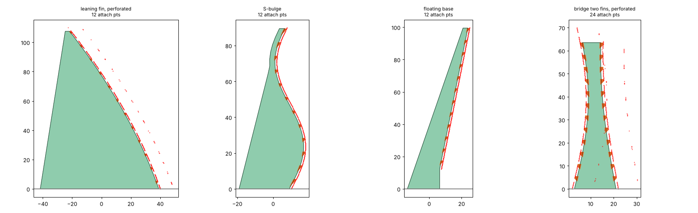

# OS_FS_support_builder

Onshape custom feature **Print Support Wall**: models thin breakaway support walls for tall, thin
3D-printed parts. Each wall stands on the print bed, follows the part's edge however it
curves, and touches the part only through a row of small teeth ("attach points").

*Wall profiles from `tools/profile_check.py` for three edge shapes: a leaning curved fin, an S-bulge,
and a part whose base sits above the bed.*

## Inputs

| Input | What it does |
| --- | --- |
| Part to support | The solid to brace |
| Support planes | One wall per plane (multi-select). The wall is centred on the plane |
| Flip support side | Which side of the part the wall stands on |
| Print bed plane | The build plate. "Up" is taken as the side the part is on |
| Max support height | Wall stops here or at the top of the part, whichever is lower |
| Wall thickness | Default 1.2 mm (3 lines at 0.4 mm) |
| Attach points by | **Count** (evenly spread) or **Spacing** (fixed pitch, centred) |
| Gap to part | Horizontal clearance between the wall and the part between teeth |
| Tooth contact width / base width | Tip land touching the part, and the tooth root width |
| Contact overlap | How far tooth tips bury into the part so they fuse in the slicer (default 0.15 mm) |
| Foot reach on bed | How far the wall's foot extends away from the part |
| Top width | Minimum wall width at the top, and the minimum width anywhere |
| Add bed pad | Thin pad under the wall bottom for adhesion (width, thickness) |
| Merge supports into part | Union walls into the part so it exports as one STL |

## How it works

1. Rays are cast across each support plane at ~1 mm height steps toward the part. The first hit at
   each height traces the part's edge in that plane, so any curve works.
2. The edge is offset by the gap, and trapezoid teeth reach back across the gap to the part.
3. The outer edge runs straight from the top to the foot, but never comes closer than *top width*
   to the inner edge.
4. The 2D profile is sketched on the plane, extruded to wall thickness, and the bed pad is unioned on.

If the part's base is above the bed (curved bottoms), the wall drops straight down from the
lowest point of contact.

## Install (paste flow)

1. In your Onshape document, create a Feature Studio.
2. Copy `src/SupportWall.fs` (PowerShell: `Get-Content -Raw src\SupportWall.fs | Set-Clipboard`).
3. Ctrl+A, Ctrl+V in the Studio, keeping the `FeatureScript <n>;` line and import version Onshape
   generated if they differ from this file's 3083, then Commit.
4. Open the Notices panel (glasses icon) and report anything listed.

## Status

**Written, not yet compiled.** The 2D profile math is checked in Python (`tools/profile_check.py`);
the Onshape API calls (`evRaycast`, `skPolyline`, `skRectangle`) are from memory and need a
first paste to confirm. See *Known unknowns* below.

### Known unknowns for the first paste
- `evRaycast` field names (`"closest"`, result `.intersection`).
- `skPolyline` closing the loop when the first and last points match.
- Whether `try silent(...)` as an expression is accepted around `evRaycast`.

## Roadmap
- **Drag handle for attach-point count/spacing.** Onshape's feature dialog has no slider widget
  that I know of. The closest equivalent is an on-canvas drag arrow (a manipulator) along the
  wall's contact edge that changes spacing live. Planned once v1 compiles.
- Triangular gusset feet (mouse-ear style) as an alternative to the flat pad.
- Normal-direction gap (currently horizontal, so clearance shrinks on steep overhangs:
  about gap × cos(lean)).

## Related docs
- [docs/STL_to_STEP.md](docs/STL_to_STEP.md): getting STL files into Onshape cleanly. Converter now lives in [the-feve/mesh2step](https://github.com/the-feve/mesh2step)
- [docs/prior_art.md](docs/prior_art.md): what already exists
